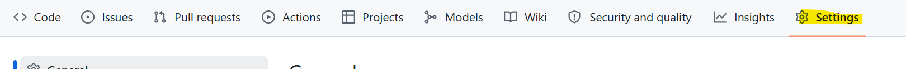
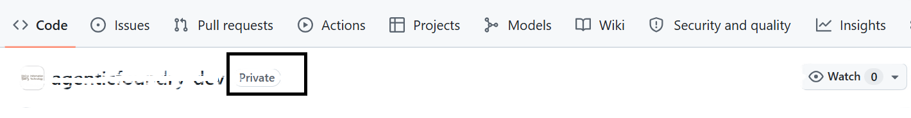

# @= repo_name =@

# What is this repository

This repository (repo) was generated from @= templates =@ version v0.3.0 by @= technical_owner =@ as part of request @= ticket =@. Infrastructure (Azure resources) deployed from this repository is deployed to different Azure resource groups, one per environment. The target resource group name can be found in a subfolder of environments folder, for example, resource_group_name variable in environments/dv/dv.tfvars.

The repository houses all the code you need to develop and deploy an Azure AI solution. Welcome to your new home. This code is yours, and you can do anything you please with it. 

CAF team followed all Nestle standards and best practices when placing sample code here. However, it is up to you to maintain and update the code. Please note this repository is disconnected from the template (meaning changes in the template will not be reflected here). Moreover, the NPET platform does not have access and will not update any content in this repository. The code, settings (and maintenance) are all yours.

## Who has access

To commit code to this repository, you need to be in the <a href="https://github.com/orgs/nestle-it/teams/@= team_name =@-write" target="_blank">@= team_name =@-write </a> team. If you're not yet part of this group, please ask the repository owner to add you.

There is another team, <a href="https://github.com/orgs/nestle-it/teams/@= team_name =@-admin" target="_blank">@= team_name =@-admin </a>, that has access to the repository settings. Only admin group members have access to Environment settings (definitions, variables, secrets). So if you are responsible for maintaining deployments (such as defining or changing environment settings), ask to be added to this team. Note: regular developers can run deployments; they just cannot change deployment or repo settings, protection/approval rules...

## Who owns the groups and can add members
  
For any inquiries regarding the repository, membership request or issue related to these groups, please reach out to the technical owner, @= technical_owner =@.

## Repository Visibility

GitHub repositories in nestle-it organization can have various levels of visibility:

- **Private**: Only specific users who have been granted access can read and contribute to the code. It is not visible to all members of the Nestlé organization by default.   
- **Internal**: Every authenticated GitHub user (that belongs to nestle-it organization) can read the code.

The visibility of this repository depends on the selection made during the ServiceNow request. You can find the visibility status of the repository next to its name on the front page.

 

Admins/owners of the repository can change visibility by:

- Clicking on the **Settings** tab in the repository menu.
- Scrolling down to the **Danger Zone** section at the bottom of the page.
- Under **Change repository visibility**, you will see the current visibility (Private or Internal) of the repository, with options to change it.

For more information, refer to [GitHub's guide on repository visibility](https://docs.github.com/en/enterprise-cloud@latest/repositories/managing-your-repositorys-settings-and-features/managing-repository-settings/setting-repository-visibility).

## Git, branching, PRs, CODEOWNERS

There are many great tutorials on Git usage. You should invest in them. Learn how to do merges, how to resolve conflicts... Get familiar with pull requests (PR) - you'll spend a lot of time in them. Understand different branching strategies (and their cost/drawbacks).

There is a file [CODEOWNERS](.github/CODEOWNERS) in the repository's .github directory that contains the individuals who can approve code review. Branch protection rules have been enabled for main branch which ensures that whenever a pull request modifies files in the repository, the codeowners are automatically requested for review and approvals. 

The CODEOWNERS content can be changed, so more developers can approve PRs. The change itself needs to be submitted as a PR and approved by the current CODEOWNER.

The branch protection policy can be changed or deleted by going to Setting (visible to repository owner and -admin team members) > Branches > Edit. The repository is set up following the best practices, and it is recommended to keep the branch protection in place. But removing the branch protection can facilitate  prototyping and exploratory development. When the branch protection is removed, the PRs are not enforced and anyone with write access to the repository can change code on main branch without a review.

## Files and folders

- src
  - Sample agent code to test MS foundry deployment. Please feel free to update your actual code and deploy it in Foundry
- iac
  - Terraform configuration files used for deployments
  - more details at [iac README](iac/README.md)
  - Please feel free to update if you want any changes in infra
- environments
  - additional environment-specific configuration files used by Terraform
  - More details at [environments README](/environments/README.md)
- .github/workflows
  - GitHub action scripts that run:
    - deployments to different environments
    - source code checks (SonarQube, Checkov...)
- images
  - folder holding images for READMEs

## How files relate

- The main configurations that are being used by the github workflows all come from the iac folder. This folder contains the configurations that will be used to build the resources that will be deployed.
- Environments were generated based on the ServiceNow request when this repository was created (but additional ones can be manually added later). They house variables used to create the infrastructure. These files are mainly used by the terraform files for the infrastructure that will be created.

# The big picture

...is documented at https://nestle.leanix.net/nestleprod/diagrams/dataflow/493861b4-f0bd-4a95-8383-580b4336ff81 

## How to deploy infrastructure

Detailed instructions on deployment are at [Workflows README](.github/workflows/README.md)

## Resources Created by this template:
- Azure key-vault
- Application insights
- Cosmos DB
- Function app
- Azure container registry
- Azure AI search
- Microsoft Foundry and created connected resources