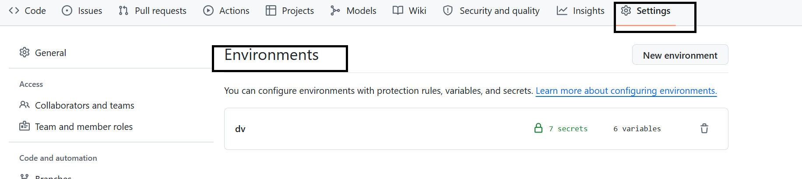
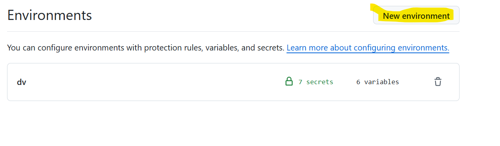

# Environments

This folder stores environment-specific values used during Terraform runs. Please note the folders here do not define the environments (they are defined in Settings section of this repository) but are complementary to the environments.

## GitHub Environments

GitHub Environments were generated when this repository was created. Github environments house variables and secrets used for deployments. 

### How to access environments

* click the Settings tab in this repository (available only to <a href="https://github.com/orgs/nestle-it/teams/@= team_name =@-admin" target="_blank">@= team_name =@-admin </a> team members).



* click the environment tab to see a list of all currently configured environments:


### Variables and Secrets

* Variables: used to configure clear text values
  * visible to repository admins
* secrets: hold sensitive values
  * values are obfuscated (to all users)
  * there is no way to see the clear text value. The only time clear text value is visible is when updating the value
  * typically used to store passwords, keys or other sensitive values

#### Notable variables

* CLIENT_ID, SUBSCRIPTION_ID, TENANT_ID are used for Azure authentication
  * GitHub workflows use OIDC and federated identity (configured in Azure) to authenticate to Azure
  * these identifiers are *not* secrets; this is a password-less and certificate-less way to authenticate
  * the managed identity has contributor role to the resource group (separate for each environment)
* detailed usage of the variables is in .github/workflows/tf-run.yml file

### How to create new environment

* navigate to Settings > Environments to see the existing environment list
* click New environment button:




#### Match GitHub Environments to environment folders

The environment folder names should match GitHub's environments. For example, when you create an environment called dv, there should be a corresponding environments/dv/dv.tfvars file.

## Terraform environments

Terraform does not have an explicit concept of environments. However, it supports passing different variable definitions from distinct files. This repo defines environment-specific values in files like environments/np/np.tfvars, and environments/pr/pr.tfvars.

The environment-specific folders and values were created when the Github Repo was generated. The ServiceNow request filled out and created the environment files used by terraform commands.

### How environment-specific variables are fed to Terraform

The environment-specific variable values (such as virtual network name, virtual network resource group, delegated subnet name ...) are matched by the environment name input to the workflow, for example (in tf-run.yml):

```terraform
terraform plan ... -var-file="${{ env.ENV_PATH }}/${{ inputs.environment_name }}.tfvars"
```

For example, if the input environment_name is selected as np, the var-file resolves to "feeding" the values from np.tfvars file.

Note that in this repo, only variable values are environment-specific. However, the directory structure makes it possible to have environment-specific infrastructure. For example, services and networks can create different resources in pr vs. np.

### Foundry resource segment variables

The Foundry resource plan loads the selected segment's `foundry-resource.tfvars`, for example [dev01](dv/europe/dev01/foundry-resource.tfvars). It does not automatically load the parent [platform.tfvars](dv/europe/platform.tfvars).

Each segment's Foundry resource variable file must supply `acr_name` and `platform_rg` for the existing shared platform container registry. Match `acr_name` to the platform configuration's `acr_name`, and `platform_rg` to its `resource_group_name`; do not use the segment's resource group for this lookup.

If the plan reports `No value for required variable` for either input, add the corresponding platform values to the selected segment's variable file.

### Azure naming conventions

The names created by the code in this repo follow Nestle's naming conventions. For example (in iac/locals.tf):

```terraform
webapp_name = "${var.solution_scope}-${var.environment_name}-${var.solution_name}-${var.solution_context}-${var.solution_region}-app"
```

Example generated name: emna-accounting-inventory-euwe-app.
